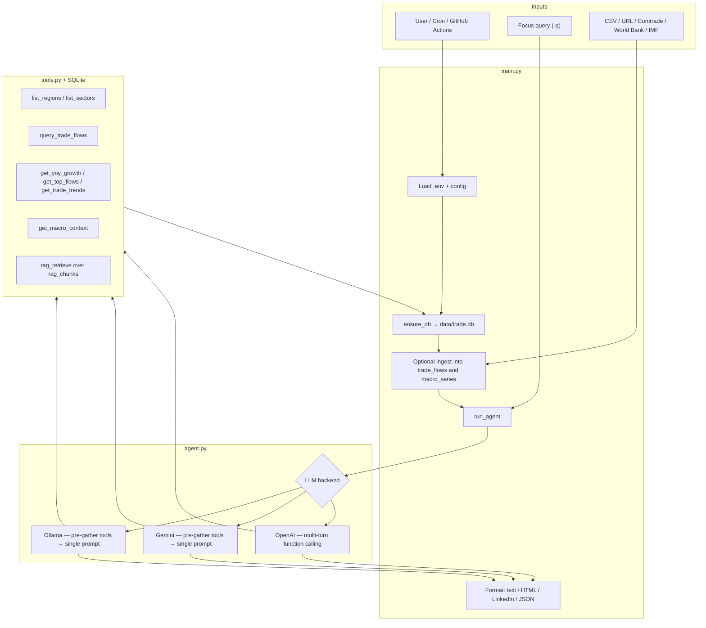

# ASAN Macro

**Public trade briefs** from a tool-grounded analyst agent.

Three briefs are already computed: BRICS minerals, US–China electronics, and Vietnam/Mexico supply into the United States. Each brief’s bars are SQL aggregates of the same rows as the text. Under **Wider accounts**, the same countries show World Bank merchandise totals and the IMF current account. Those country totals stay off the commodity chart so a multi-trillion export figure does not flatten an HS chapter.

The panel is live data:

- **UN Comtrade** annual merchandise for HS 26 (minerals), 27 (energy), 61–62 (textiles), 84 and 87 (machinery and vehicles), and 85 (electronics), 2022–2024
- **World Bank** merchandise exports and imports, current US dollars
- **IMF** World Economic Outlook current account, in dollars and as a percent of GDP

Refresh all three with `python scripts/export_gallery.py --live`. The 18-row synthetic seed remains only for offline tests. The public Comtrade preview does not return the India reporter, so that energy corridor is omitted rather than filled with the old sample.

**Live site:** [https://asan-macro.vercel.app](https://asan-macro.vercel.app)

The briefs on that URL need no API key. A typed question calls the Python API. Until that API is deployed (`render.yaml`) and `NEXT_PUBLIC_AGENT_API_URL` is set on the Vercel project, the ask box says generation is not connected and leaves the closest corridor on screen. The deployed site picks up a new gallery when `web/` is pushed.

## How to use the agent

### On the website

1. Open the site and pick a corridor: **BRICS**, **US–China electronics**, or **Vietnam and Mexico**.
2. Read Summary, Key regions and sectors, So what, and What’s next. The bars beside the text are the same HS rows.
3. Read **Wider accounts** for World Bank goods totals and the IMF current account for those countries.
4. Ask a short trade question in the box (200 characters or fewer). Examples: `BRICS minerals and energy`, `US-China electronics`, `Vietnam textiles`.
5. The question stays on screen while the service checks the cache and, on a miss, asks the model. The bars that come back use the same region and sector filter as the tools.
6. A repeated question is free if it is already cached. A new generation is limited to five an hour per IP. Instruction overrides are refused before any model call. The site does not accept a file or URL upload.

If generation is unavailable, the page says so and keeps the closest corridor.

### On your machine

The CLI is the agent. One command reads the local database, calls the tools, asks the model, and writes a four-section brief.

```bash
pip install -r requirements.txt
cp .env.example .env
```

Put **one** model in `.env`, then run a focus:

```bash
# Local, no API key
# USE_LOCAL_LLM=1
# OLLAMA_MODEL=qwen2:7b
ollama serve
python main.py -q "US-China electronics" -o report.txt

# or a cloud key instead of Ollama
# GEMINI_API_KEY=...    or    OPENAI_API_KEY=...
python main.py -q "BRICS minerals and energy" -o report.txt
```

Omit `-q` for a full-panel read. Other formats:

```bash
python main.py -q "Vietnam textiles" -o report.html -f html
python main.py -q "Mexico manufacturing" -o report.json -f json
python main.py -q "BRICS" -o report.txt -f linkedin
```

| Flag | What it does |
|------|----------------|
| `-q` / `--query` | Focus, treated as data. Examples: `BRICS`, `US-China electronics`. |
| `-o` / `--output` | Report path. Default is a timestamped file in the project root. |
| `-f` | `text` (default), `html`, `linkedin` (report plus a one-liner), or `json`. |
| `-d` / `--data` | Load a CSV into the database before the brief. |
| `--data-url` | Load a CSV from an https URL on the host allowlist. |
| `--replace-data` | Clear `trade_flows` before that CSV load. |

The first run creates `data/trade.db` and, if it is empty, fills it with the 18-row synthetic seed so the agent can run offline. That seed is not official trade data.

To point the CLI and the API at the live HS corridors, then add World Bank and IMF rows to the same database:

```bash
python scripts/fetch_comtrade.py --corridors --replace
python -c "from macro_data import fetch_macro, load_macro; print(load_macro(fetch_macro()))"
python main.py -q "US-China electronics" -o report.txt
```

`--replace` clears commodity rows before the Comtrade insert. `load_macro` replaces only `macro_series`. The model then sees those accounts through `get_macro_context`.

What you get back is a brief with four headings — Summary, Key regions and sectors, So what, What’s next — plus a disclaimer. `Refused:` means the query guard stopped the call. `Error:` means no model was configured, or the provider failed. A canned sample is written only when `ASAN_DEMO_FALLBACK=1`.

### Local site plus the API

The site reads the gallery at build time. The ask box calls the API only when `NEXT_PUBLIC_AGENT_API_URL` is set.

```bash
python scripts/export_gallery.py --live
cd web && npm install && NEXT_PUBLIC_AGENT_API_URL=http://127.0.0.1:8000 npm run dev
```

In another terminal, from the repo root, with the same `.env` the CLI uses:

```bash
uvicorn api.app:app --port 8000
```

`export_gallery.py --live` writes `gallery/index.json` and `web/data/gallery.json` from a temporary database. It does not replace `data/trade.db`. Use the `fetch_comtrade.py` commands above when you want the CLI or API process itself to query the live rows.

Without `NEXT_PUBLIC_AGENT_API_URL`, `npm run dev` still shows the briefs and says generation is not connected.

## Run it locally

```bash
pip install -r requirements.txt
cp .env.example .env   # one LLM backend, only needed for a generated brief
python scripts/export_gallery.py --live
cd web && npm install && npm run dev
```

CLI, after the database exists:

```bash
python main.py -q "BRICS" -o report.txt
```

---

## Functionality

ASAN Macro is a trade analyst agent. The public site in `web/` shows precomputed briefs and charts. The same core still runs as a CLI: one command loads data (if needed), queries a local database through tools, calls an LLM, and writes the report to disk.

### What it does

| Capability | Behavior |
|------------|----------|
| **Trade sentiment reporting** | Generates a short narrative with thematic synthesis, key regions/sectors, implications (**so what**), and outlook (**what’s next**), wrapped in `REPORT_START` / `REPORT_END`. |
| **Focus queries** | Optional `-q` (e.g. `BRICS`, `US-China electronics`) steers analysis; omit it for a full-database read. |
| **Tool-grounded analysis** | The LLM is backed by ten tools over SQLite—not free-form guessing alone—so claims can be tied to stored flows, macro series, and bulletins. |
| **Multi-backend LLMs** | First available backend: **Ollama** → **Gemini** → **OpenAI**. OpenAI runs a multi-turn tool loop. Ollama and Gemini get a focus-specific tool pack, then write once. Gemini receives the system prompt. |
| **Dynamic data ingest** | `scripts/export_gallery.py --live` rebuilds the site from Comtrade, World Bank, and IMF. `scripts/fetch_comtrade.py --corridors --replace` loads those HS rows into `data/trade.db`. CSV (`-d`) and an allowlisted `--data-url` still work. |
| **Multiple output formats** | `text` (default), `html`, `linkedin` (report + short one-liner file), or `json` (structured fields for dashboards/APIs). |
| **Evaluation** | `evaluation/run_evaluation.py` runs multiple focus queries and scores section presence, length, and runtime. |
| **Adversarial / safety probes** | `guard_query` refuses instruction-override text before any model call (unit tested). Inputs that pass the guard are not yet recorded against a live model. |
| **Scheduled runs** | Cron helper (`scripts/run_scheduled.sh`) and GitHub Actions can ingest + generate recurring report artifacts. |
| **Colab demo path** | `colab_setup.ipynb` supports cloud runs with Gemini or OpenAI (no local Ollama). |

### Inputs and outputs

| | Details |
|--|---------|
| **Inputs** | SQLite (`data/trade.db`: `trade_flows`, `macro_series`, `rag_chunks`); the gallery JSON the site imports; optional CSV/URL/Comtrade; optional focus query; `.env` LLM config. |
| **CSV columns** | `year`, `reporter_region`, `partner_region`, `sector`, `flow_type`, `value_usd`. |
| **Outputs** | Report file (+ console print). HTML is escaped for safer viewing; JSON exposes summary, bullets, so_what, whats_next. |

### Analyst tools (what the agent can query)

| Tool | Function |
|------|----------|
| `list_regions` / `list_sectors` | Discover entities in the database |
| `query_trade_flows` | Filter flows by reporter, partner, sector, year range |
| `get_region_summary` / `get_sector_summary` | Aggregate values for a region or sector |
| `get_yoy_growth` | Year-over-year growth via SQL window logic |
| `get_top_flows` | Top-N flows by value |
| `get_trade_trends` | First-year vs last-year deltas |
| `get_macro_context` | World Bank merchandise totals and the IMF current account for one country, or the loaded set |
| `rag_retrieve` | Keyword retrieval over stored trade bulletin chunks |

### Typical use

```bash
# Full analysis on whatever is already in data/trade.db
python main.py -o report.txt

# Focused brief + LinkedIn one-liner
python main.py -q "BRICS" -o report.txt -f linkedin

# Ingest CSV, then analyze
python main.py -q "US-China electronics" -d sample_trade.csv -o report.html -f html
```

Intended users: economists, macro strategists, and policy/business readers who need a consistent, data-tied brief instead of a manual spreadsheet-to-chatbot workflow.

---

## Logical flow

End-to-end pipeline from user input to report:



### Step-by-step

| Step | Component | What happens |
|------|-----------|--------------|
| **1. Configure** | `config.py`, `.env` | Load API keys / Ollama settings. Backend priority: **Ollama → Gemini → OpenAI**. |
| **2. Persist** | `database.py` | Create/seed `data/trade.db` (`trade_flows`, `rag_chunks`) if missing. |
| **3. Ingest (optional)** | `scripts/fetch_comtrade.py`, `macro_data.py`, `data_ingestion.py` | Load Comtrade HS corridors, World Bank and IMF series, or a CSV before analysis. |
| **4. Ground** | `tools.py` | Ten tools query structured flows, macro series, and keyword RAG so the model reasons over **data**, not only priors. |
| **5. Reason** | `agent.py` | LLM synthesizes themes (e.g. BRICS, US–China, South–South). OpenAI uses a true tool-calling loop; Ollama/Gemini use deterministic pre-tooling + one synthesis call for portability. |
| **6. Deliver** | `main.py` | Extract `REPORT_START`…`REPORT_END` and write text / HTML / LinkedIn one-liner / structured JSON. |
| **7. Assure** | `evaluation/` | Completeness metrics across focus queries; adversarial cases for prompt leak, jailbreak-style, off-topic, and gibberish inputs. |
| **8. Operate** | GitHub Actions / cron | Optional scheduled ingest + report artifacts for recurring briefs. |

For diagrams and deeper run notes, see [LOGIC_FLOW_DIAGRAM.md](LOGIC_FLOW_DIAGRAM.md) and [RUN_AND_LOGIC.md](RUN_AND_LOGIC.md).

---

## Why I designed it this way

| Design choice | My rationale |
|---------------|--------------|
| **Tools over raw prompt stuffing** | Map analyst questions to named tools (YoY, top flows, trends)—clearer, testable, closer to production agents. |
| **Multi-backend orchestration** | Local Ollama for zero-quota demos; Gemini/OpenAI when quality or function calling matters. |
| **Structured report contract** | Fixed sections make outputs usable for briefs and measurable in evaluation. |
| **Evaluation + adversarial suite** | Treat agent quality and misuse resistance as engineering problems, not afterthoughts. |
| **CLI + artifacts first** | Keep the surface small while proving the full data → insight loop. |

---

## Quick start

```bash
pip install -r requirements.txt
cp .env.example .env   # configure one LLM backend
python main.py -q "BRICS minerals and energy" -o report.txt
```

### LLM backends (pick one)

| Backend | Setup | Best for |
|---------|--------|----------|
| **Ollama (recommended)** | `ollama pull qwen2:7b` · `.env`: `USE_LOCAL_LLM=1`, `OLLAMA_MODEL=qwen2:7b` | Local demos, no API quota |
| **Gemini** | `GEMINI_API_KEY=...` | Free-tier cloud runs |
| **OpenAI** | `OPENAI_API_KEY=...` | Full multi-turn tool calling |

### Common commands

```bash
python main.py -q "BRICS" -o report.txt
python main.py -q "US-China electronics" -d sample_trade.csv -o report.txt
python main.py -q "BRICS" -o report.html -f html
python main.py -o report.json -f json
python scripts/fetch_comtrade.py --corridors --replace && python main.py -q "BRICS" -o report.txt
python scripts/export_gallery.py --live
python evaluation/run_evaluation.py
python evaluation/adversarial_test.py
```

| Flag | Description |
|------|-------------|
| `-q` / `--query` | Focus the analysis (e.g. BRICS, US-China electronics) |
| `-o` / `--output` | Output path (default: timestamped report file) |
| `-d` / `--data` | Load CSV into DB before analysis |
| `--data-url` | Load CSV from a URL |
| `-f` | `text` \| `html` \| `linkedin` \| `json` |

---

## Architecture

```
ASAN_AI_Project/
├── main.py                 # CLI entry: ingest → agent → format output
├── agent.py                # LLM orchestration (Ollama / Gemini / OpenAI)
├── tools.py                # Analyst tools over SQLite, macro series, and RAG
├── report_contract.py      # Brief schema, query guard, disclaimer
├── focus.py                # Focus-specific tool pack
├── macro_data.py           # World Bank and IMF fetch, store, and sentences
├── gallery_build.py        # SQL charts + three briefs + wider accounts
├── api/app.py              # Cached, rate-limited live API
├── web/                    # Next.js public site
├── database.py             # Schema + offline seed
├── data_ingestion.py       # CSV / allowlisted https ingest
├── config.py               # Env, paths, model helpers
├── evaluation/
│   ├── run_evaluation.py   # Completeness / runtime harness
│   └── adversarial_test.py # Misuse / injection-style probes
├── scripts/
│   ├── fetch_comtrade.py   # UN Comtrade HS corridors → DB
│   ├── export_gallery.py   # --live rebuilds the site JSON; default is the seed
│   └── run_scheduled.sh    # Ingest + report for cron
├── .github/workflows/
│   ├── ci.yml
│   └── scheduled_report.yml
└── data/                   # trade.db created on first run
```

**Agent tools:** `list_regions`, `list_sectors`, `query_trade_flows`, `get_region_summary`, `get_sector_summary`, `get_yoy_growth`, `get_top_flows`, `get_trade_trends`, `get_macro_context`, `rag_retrieve`.

---

## Evaluation & safety

| Practice | Location | Intent |
|----------|----------|--------|
| Completeness metrics (sections, length, runtime) | `evaluation/run_evaluation.py` | Measure report fitness across focus queries |
| Adversarial probes (prompt leak, jailbreak-style, off-topic, gibberish) | `evaluation/adversarial_test.py` | Surface misuse and grounding failures early |
| Secrets hygiene | `.env` / GitHub Actions secrets | No hardcoded API keys |
| Parameterized SQL | `tools.py` | Reduce injection risk in DB tools |
| HTML escaping | `main.py` | Safer rendered report artifacts |

Details: [EVALUATION_AND_SAFETY.md](EVALUATION_AND_SAFETY.md).

---

## Live data & scheduling

- **UN Comtrade corridors:** [DOC_COMTRADE.md](DOC_COMTRADE.md) · `python scripts/fetch_comtrade.py --corridors --replace`
- **World Bank and IMF:** `python -c "from macro_data import fetch_macro, load_macro; print(load_macro(fetch_macro()))"`
- **Site gallery:** `python scripts/export_gallery.py --live`
- **Cron / Actions:** [SCHEDULING.md](SCHEDULING.md) · `scripts/run_scheduled.sh` · weekly workflow in `.github/workflows/`

---

## Google Colab

[](https://colab.research.google.com/github/Arnav504/ASAN_AI_Project/blob/main/colab_setup.ipynb)

1. Open the notebook → clone → `pip install -r requirements.txt`
2. Set `GEMINI_API_KEY` or `OPENAI_API_KEY` (Colab cannot run Ollama)
3. `!python main.py -q "BRICS" -o report.txt`

Prefer Colab **Secrets** over pasting keys into cells.

---

## Ownership

I completed this project alone: architecture, agent orchestration, tools/DB/RAG, ingestion and scheduling, evaluation and adversarial safety documentation, and portfolio-facing documentation. Interview talking points: [LINKEDIN_PROJECT.md](LINKEDIN_PROJECT.md).

---

## What shipped for the public demo

- Next.js site (`web/`) with three corridor briefs, SQL charts, Wider accounts, and a tool trace.
- FastAPI service (`api/app.py`): cache, background jobs, five new generations per IP per hour. No public file or URL upload.
- Pydantic brief contract, focus-specific tool pack, Gemini system prompt, disclaimer on every brief.
- Query guard and an https host allowlist for operator `--data-url`.
- Pytest plus a pull-request workflow. No live LLM in CI.
- `avg_word_count` in the evaluation harness is a mean (the committed 12-run file now says 373, not the old sum of 4479).

## Still later

Embedding retrieval, citation checks against a gold set, a live adversarial model run in CI, and a Comtrade-scale corpus. Keyword RAG and the OpenAI-only tool loop are unchanged on purpose for this pass.

Course and debug notes live in [docs/archive](docs/archive).

---

## Skills demonstrated

LLM agents · function calling · RAG · prompt engineering · AI evaluation · adversarial / prompt-injection testing · secure secrets handling · SQL · data ingestion · Python · OpenAI / Gemini / Ollama · GitHub Actions

---

## License

Use as needed for academic and portfolio purposes. Keep API keys out of the repository.
