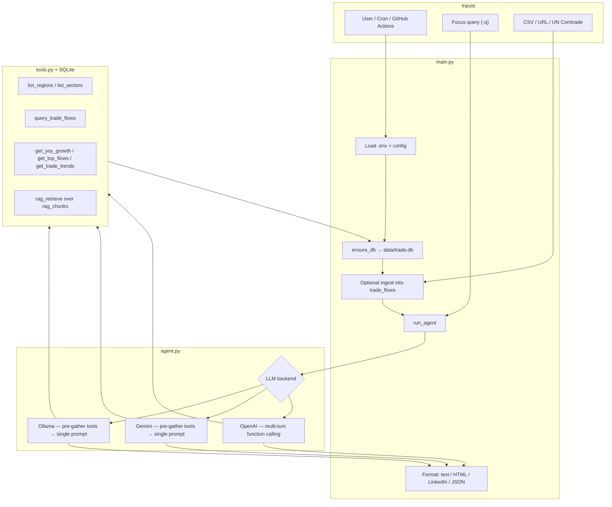

# ASAN Macro

**Public trade briefs** from a tool-grounded analyst agent.

Open the site and three sample briefs are already there: BRICS minerals and energy, US–China electronics, and Vietnam/Mexico supply into the United States. The bars are SQL aggregates from the same seeded panel as the text. A live box can ask the model a short focus; repeated questions come from cache, and new generations are limited to five an hour. If the model is still running or the API is down, the closest sample stays on screen.

The panel is an **illustrative synthetic set of 18 flows (2022–2024)**. It is not official UN Comtrade statistics.

**Live site:** [https://asan-macro.vercel.app](https://asan-macro.vercel.app)

The samples are on that URL with no API key. Live generation still needs the Python API from `render.yaml`: set `GEMINI_API_KEY` or `OPENAI_API_KEY` there, then set `NEXT_PUBLIC_AGENT_API_URL` on the Vercel project and redeploy `web/`. Until that API exists, the live box says generation is not connected and the sample briefs stay up.

## Run it locally

```bash
pip install -r requirements.txt
cp .env.example .env   # one LLM backend, only needed for live generation
python scripts/export_gallery.py
cd web && npm install && npm run dev
```

In another terminal, the live API:

```bash
uvicorn api.app:app --port 8000
```

Point the site at it with `NEXT_PUBLIC_AGENT_API_URL=http://127.0.0.1:8000` before `npm run dev`. Without that variable the samples still render and the live box says generation is not connected.

CLI, unchanged:

```bash
python main.py -q "BRICS" -o report.txt
```

---

## Functionality

ASAN Macro is a trade analyst agent. The public site in `web/` shows precomputed briefs and charts. The same core still runs as a CLI: one command loads data (if needed), queries a local database through tools, calls an LLM, and writes the report to disk.

### What it does

| Capability | Behavior |
|------------|----------|
| **Trade sentiment reporting** | Generates a short narrative with thematic synthesis, key regions/sectors, implications (**so what**), and outlook (**what’s next**), wrapped in `REPORT_START` / `REPORT_END`. |
| **Focus queries** | Optional `-q` (e.g. `BRICS`, `US-China electronics`) steers analysis; omit it for a full-database read. |
| **Tool-grounded analysis** | The LLM is backed by nine tools over SQLite—not free-form guessing alone—so claims can be tied to stored flows and bulletins. |
| **Multi-backend LLMs** | First available backend: **Ollama** → **Gemini** → **OpenAI**. OpenAI runs a multi-turn tool loop. Ollama and Gemini get a focus-specific tool pack, then write once. Gemini receives the system prompt. |
| **Dynamic data ingest** | Load local CSV (`-d`), CSV from URL (`--data-url`), or UN Comtrade via `scripts/fetch_comtrade.py`. `--replace-data` clears seed rows before loading. |
| **Multiple output formats** | `text` (default), `html`, `linkedin` (report + short one-liner file), or `json` (structured fields for dashboards/APIs). |
| **Evaluation** | `evaluation/run_evaluation.py` runs multiple focus queries and scores section presence, length, and runtime. |
| **Adversarial / safety probes** | `guard_query` refuses instruction-override text before any model call (unit tested). Inputs that pass the guard are not yet recorded against a live model. |
| **Scheduled runs** | Cron helper (`scripts/run_scheduled.sh`) and GitHub Actions can ingest + generate recurring report artifacts. |
| **Colab demo path** | `colab_setup.ipynb` supports cloud runs with Gemini or OpenAI (no local Ollama). |

### Inputs and outputs

| | Details |
|--|---------|
| **Inputs** | Seeded SQLite DB (`data/trade.db`: `trade_flows`, `rag_chunks`); optional CSV/URL/Comtrade; optional focus query; `.env` LLM config. |
| **CSV columns** | `year`, `reporter_region`, `partner_region`, `sector`, `flow_type`, `value_usd`. |
| **Outputs** | Report file (+ console print). HTML is escaped for safer viewing; JSON exposes summary, bullets, so_what, whats_next. |

### Analyst tools (what the agent can query)

| Tool | Function |
|------|----------|
| `list_regions` / `list_sectors` | Discover entities in the database |
| `query_trade_flows` | Filter flows by reporter, partner, sector, year range |
| `get_region_summary` / `get_sector_summary` | Aggregate values for a region or sector |
| `get_yoy_growth` | Year-over-year growth via SQL window logic |
| `get_top_flows` | Top-N flows by value |
| `get_trade_trends` | First-year vs last-year deltas |
| `rag_retrieve` | Keyword retrieval over stored trade bulletin chunks |

### Typical use

```bash
# Full analysis on seeded (or previously ingested) data
python main.py -o report.txt

# Focused brief + LinkedIn one-liner
python main.py -q "BRICS" -o report.txt -f linkedin

# Ingest CSV, then analyze
python main.py -q "US-China electronics" -d sample_trade.csv -o report.html -f html
```

Intended users: economists, macro strategists, and policy/business readers who need a consistent, data-tied brief instead of a manual spreadsheet-to-chatbot workflow.

---

## Logical flow

End-to-end pipeline from user input to report:



### Step-by-step

| Step | Component | What happens |
|------|-----------|--------------|
| **1. Configure** | `config.py`, `.env` | Load API keys / Ollama settings. Backend priority: **Ollama → Gemini → OpenAI**. |
| **2. Persist** | `database.py` | Create/seed `data/trade.db` (`trade_flows`, `rag_chunks`) if missing. |
| **3. Ingest (optional)** | `data_ingestion.py`, `scripts/fetch_comtrade.py` | Load CSV, CSV URL, or UN Comtrade into the DB before analysis. |
| **4. Ground** | `tools.py` | Nine tools query structured flows and keyword RAG so the model reasons over **data**, not only priors. |
| **5. Reason** | `agent.py` | LLM synthesizes themes (e.g. BRICS, US–China, South–South). OpenAI uses a true tool-calling loop; Ollama/Gemini use deterministic pre-tooling + one synthesis call for portability. |
| **6. Deliver** | `main.py` | Extract `REPORT_START`…`REPORT_END` and write text / HTML / LinkedIn one-liner / structured JSON. |
| **7. Assure** | `evaluation/` | Completeness metrics across focus queries; adversarial cases for prompt leak, jailbreak-style, off-topic, and gibberish inputs. |
| **8. Operate** | GitHub Actions / cron | Optional scheduled ingest + report artifacts for recurring briefs. |

For diagrams and deeper run notes, see [LOGIC_FLOW_DIAGRAM.md](LOGIC_FLOW_DIAGRAM.md) and [RUN_AND_LOGIC.md](RUN_AND_LOGIC.md).

---

## Why I designed it this way

| Design choice | My rationale |
|---------------|--------------|
| **Tools over raw prompt stuffing** | Map analyst questions to named tools (YoY, top flows, trends)—clearer, testable, closer to production agents. |
| **Multi-backend orchestration** | Local Ollama for zero-quota demos; Gemini/OpenAI when quality or function calling matters. |
| **Structured report contract** | Fixed sections make outputs usable for briefs and measurable in evaluation. |
| **Evaluation + adversarial suite** | Treat agent quality and misuse resistance as engineering problems, not afterthoughts. |
| **CLI + artifacts first** | Keep the surface small while proving the full data → insight loop. |

---

## Quick start

```bash
pip install -r requirements.txt
cp .env.example .env   # configure one LLM backend
python main.py -q "BRICS" -o report.txt
# or: ./run.sh -q "BRICS" -o report.txt
```

### LLM backends (pick one)

| Backend | Setup | Best for |
|---------|--------|----------|
| **Ollama (recommended)** | `ollama pull qwen2:7b` · `.env`: `USE_LOCAL_LLM=1`, `OLLAMA_MODEL=qwen2:7b` | Local demos, no API quota |
| **Gemini** | `GEMINI_API_KEY=...` | Free-tier cloud runs |
| **OpenAI** | `OPENAI_API_KEY=...` | Full multi-turn tool calling |

### Common commands

```bash
python main.py -q "BRICS" -o report.txt
python main.py -q "US-China electronics" -d sample_trade.csv -o report.txt
python main.py -q "BRICS" -o report.html -f html
python main.py -o report.json -f json
python scripts/fetch_comtrade.py && python main.py -q "BRICS" -o report.txt
python evaluation/run_evaluation.py
python evaluation/adversarial_test.py
```

| Flag | Description |
|------|-------------|
| `-q` / `--query` | Focus the analysis (e.g. BRICS, US-China electronics) |
| `-o` / `--output` | Output path (default: timestamped report file) |
| `-d` / `--data` | Load CSV into DB before analysis |
| `--data-url` | Load CSV from a URL |
| `-f` | `text` \| `html` \| `linkedin` \| `json` |

---

## Architecture

```
ASAN_AI_Project/
├── main.py                 # CLI entry: ingest → agent → format output
├── agent.py                # LLM orchestration (Ollama / Gemini / OpenAI)
├── tools.py                # Nine analyst tools over SQLite + RAG
├── report_contract.py      # Brief schema, query guard, disclaimer
├── focus.py                # Focus-specific tool pack
├── gallery_build.py        # SQL charts + three sample briefs
├── api/app.py              # Cached, rate-limited live API
├── web/                    # Next.js public site
├── database.py             # Schema + seed data
├── data_ingestion.py       # CSV / allowlisted https ingest
├── config.py               # Env, paths, model helpers
├── evaluation/
│   ├── run_evaluation.py   # Completeness / runtime harness
│   └── adversarial_test.py # Misuse / injection-style probes
├── scripts/
│   ├── fetch_comtrade.py   # UN Comtrade → DB
│   ├── export_gallery.py   # Rewrite gallery JSON from the seed
│   └── run_scheduled.sh    # Ingest + report for cron
├── .github/workflows/
│   ├── ci.yml
│   └── scheduled_report.yml
└── data/                   # trade.db created on first run
```

**Agent tools:** `list_regions`, `list_sectors`, `query_trade_flows`, `get_region_summary`, `get_sector_summary`, `rag_retrieve`, `get_yoy_growth`, `get_top_flows`, `get_trade_trends`.

---

## Evaluation & safety

| Practice | Location | Intent |
|----------|----------|--------|
| Completeness metrics (sections, length, runtime) | `evaluation/run_evaluation.py` | Measure report fitness across focus queries |
| Adversarial probes (prompt leak, jailbreak-style, off-topic, gibberish) | `evaluation/adversarial_test.py` | Surface misuse and grounding failures early |
| Secrets hygiene | `.env` / GitHub Actions secrets | No hardcoded API keys |
| Parameterized SQL | `tools.py` | Reduce injection risk in DB tools |
| HTML escaping | `main.py` | Safer rendered report artifacts |

Details: [EVALUATION_AND_SAFETY.md](EVALUATION_AND_SAFETY.md).

---

## Live data & scheduling

- **UN Comtrade:** [DOC_COMTRADE.md](DOC_COMTRADE.md) · `python scripts/fetch_comtrade.py`
- **Cron / Actions:** [SCHEDULING.md](SCHEDULING.md) · `scripts/run_scheduled.sh` · weekly workflow in `.github/workflows/`

---

## Google Colab

[](https://colab.research.google.com/github/Arnav504/ASAN_AI_Project/blob/main/colab_setup.ipynb)

1. Open the notebook → clone → `pip install -r requirements.txt`
2. Set `GEMINI_API_KEY` or `OPENAI_API_KEY` (Colab cannot run Ollama)
3. `!python main.py -q "BRICS" -o report.txt`

Prefer Colab **Secrets** over pasting keys into cells.

---

## Ownership

I completed this project alone: architecture, agent orchestration, tools/DB/RAG, ingestion and scheduling, evaluation and adversarial safety documentation, and portfolio-facing documentation. Interview talking points: [LINKEDIN_PROJECT.md](LINKEDIN_PROJECT.md).

---

## What shipped for the public demo

- Next.js site (`web/`) with three sample briefs, SQL charts, and a tool trace.
- FastAPI service (`api/app.py`): cache, background jobs, five new generations per IP per hour. No public file or URL upload.
- Pydantic brief contract, focus-specific tool pack, Gemini system prompt, disclaimer on every brief.
- Query guard and an https host allowlist for operator `--data-url`.
- Pytest plus a pull-request workflow. No live LLM in CI.
- `avg_word_count` in the evaluation harness is a mean (the committed 12-run file now says 373, not the old sum of 4479).

## Still later

Embedding retrieval, citation checks against a gold set, a live adversarial model run in CI, and a Comtrade-scale corpus. Keyword RAG and the OpenAI-only tool loop are unchanged on purpose for this pass.

Course and debug notes live in [docs/archive](docs/archive).

---

## Skills demonstrated

LLM agents · function calling · RAG · prompt engineering · AI evaluation · adversarial / prompt-injection testing · secure secrets handling · SQL · data ingestion · Python · OpenAI / Gemini / Ollama · GitHub Actions

---

## License

Use as needed for academic and portfolio purposes. Keep API keys out of the repository.
